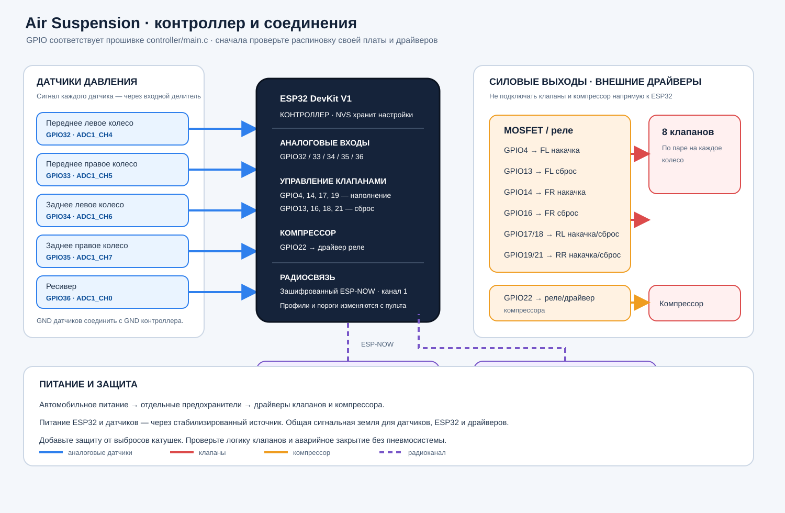

# Air Suspension

ESP32-система управления пневмоподвеской: контроллер измеряет давление, управляет клапанами и компрессором, а настройки изменяются с беспроводного пульта.

**[Открыть веб-флешер](https://1filth1.github.io/air-suspension/webflasher/?v=rc4)** · [Все релизы](https://github.com/1filth1/air-suspension/releases)

> Проект находится в стадии release candidate. Перед подключением пневматических исполнительных механизмов проверьте распиновку, логику выходов и аварийное отключение на стенде.

## Как устроена система

Контроллер на ESP32 DevKit V1 — основной источник настроек. В его энергонезависимой памяти NVS хранятся:

- профили PARK, DRIVE и LIFT для четырёх колёс;
- пределы давления колёс и ресивера;
- пороги включения компрессора и параметры регулирования;
- калибровки пяти датчиков давления и эталонные значения.

Пульты T-Display, 2″ ST7789 и компактный брелок TTGO T-Display подключаются к контроллеру по зашифрованному ESP-NOW на канале 1. Пульт загружает настройки после соединения, показывает значения контроллера и отправляет изменения обратно. Экран, подсветка и громкость пульта остаются локальными настройками.

## Возможности

- Телеметрия четырёх колёс и ресивера.
- Запуск трёх профилей давления и ручное управление клапанами.
- Компактный брелок с телеметрией ресивера и четырёх колёс, ручным управлением по одному колесу и защитой по таймауту связи.
- Автоматическая регулировка давления.
- Настройка порогов компрессора с пульта.
- Калибровка датчиков с сохранением в контроллере.
- Подтверждение записи настроек на экране пульта.
- Веб-флешер с выбором релиза и устройства.

## Состав

| Устройство | Назначение |
| --- | --- |
| ESP32 DevKit V1 | Контроллер, датчики, клапаны, компрессор |
| ESP32-S3 T-Display | Цветной беспроводной пульт |
| ESP32 + ST7789, 2″ | Дополнительный беспроводной пульт |
| TTGO T-Display (ESP32, 135×240) | Компактный брелок-пульт с двумя кнопками |
| Внешние драйверы | Силовое управление клапанами и реле компрессора |

Папки CYD содержат диагностические экраны и не являются поддерживаемыми пультами проекта.

## Схема подключения

Распиновка, таблицы сигналов и требования к питанию приведены в [инструкции по подключению](docs/wiring.md).

### Краткая распиновка контроллера

| Сигнал | GPIO ESP32 | Канал |
| --- | ---: | --- |
| Переднее левое колесо | 32 | ADC1_CH4 |
| Переднее правое колесо | 33 | ADC1_CH5 |
| Заднее левое колесо | 34 | ADC1_CH6 |
| Заднее правое колесо | 35 | ADC1_CH7 |
| Ресивер | 36 | ADC1_CH0 |
| Наполнение колёс FL / FR / RL / RR | 4 / 14 / 17 / 19 | Выходы драйверов |
| Сброс колёс FL / FR / RL / RR | 13 / 16 / 18 / 21 | Выходы драйверов |
| Реле/драйвер компрессора | 22 | Выход |

## Прошивка

Открой [веб-флешер](https://1filth1.github.io/air-suspension/webflasher/?v=rc4) в Chrome или Edge:

1. Выбери релиз и тип платы.
2. Подключи устройство к компьютеру по USB и выбери его в браузере.
3. Запусти прошивку и дождись сообщения об успешном завершении.
4. Повтори для контроллера и нужного пульта, выбрав одну и ту же версию.

Файлы прошивки — разреженные Intel HEX: они обновляют загрузчик, таблицу разделов и приложение, сохраняя область NVS с настройками автомобиля. **Не выбирай полное стирание памяти**, если не собираешься сбросить настройки и калибровки контроллера.

## Сборка из исходников

- Контроллер: проект ESP-IDF в каталоге [controller](controller/).
- Пульты: проекты PlatformIO в каталогах [T-Display](button%20pult%20t-display/), [2″ ST7789](buttonpult%202%20inch/) и [брелок TTGO T-Display](keychain/).
- GitHub Actions собирает образы всех поддерживаемых устройств и обновляет файлы для веб-флешера.

## Структура репозитория

- [controller/main.c](controller/main.c) — прошивка контроллера.
- [button pult t-display/main.cpp](button%20pult%20t-display/main.cpp) — прошивка T-Display.
- [buttonpult 2 inch/main.cpp](buttonpult%202%20inch/main.cpp) — прошивка 2″ ST7789.
- [keychain/main.cpp](keychain/main.cpp) — прошивка компактного брелока.
- [docs/wiring.svg](docs/wiring.svg) и [docs/wiring.md](docs/wiring.md) — схема и инструкция подключения.
- [webflasher](webflasher/) — веб-флешер и прошивки для него.
- [.github/workflows/release-candidate.yml](.github/workflows/release-candidate.yml) — сборка firmware и обновление зеркала образов.

## Ограничения по подключению

GPIO ESP32 — логические сигналы малой мощности. Подключай клапаны и компрессор только через соответствующие автомобильные драйверы или реле с защитой от выбросов и предохранителями. Не подключай индуктивную нагрузку напрямую к плате.

Сигнал датчика подавай на ADC через предусмотренный входной делитель. Не подавай 5 В непосредственно на GPIO ESP32. Для датчиков и контроллера используй подходящий стабилизированный источник и общую сигнальную землю. Подробности и предупреждения — в [инструкции по подключению](docs/wiring.md).
